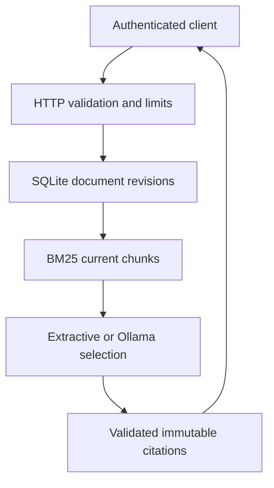

# Architecture and engineering notes

## Data flow

The HTTP adapter owns authentication, request validation, concurrency and response formats. `Store` owns transactions and immutable source metadata. Retrieval is a pure BM25 function. `answer` composes retrieval with optional provider selection and is independently testable.

## SQLite model

| Table | Key | Purpose |
|---|---|---|
| `documents` | UUID | Current revision pointer and timestamps |
| `revisions` | document ID + revision | Immutable normalized content, filename, hash |
| `chunks` | SHA-derived source ID | Exact line window attached to a revision |

Creating and updating a document uses `BEGIN IMMEDIATE`. A stale `expectedRevision` returns 409 within the transaction, preventing silent overwrite. Old revisions are retained so a previously shared citation remains inspectable after an edit. Deleting a document intentionally cascades to every revision/chunk: privacy deletion takes precedence over citation availability.

This design is a useful small-service boundary, not a scale claim. With larger corpora, move token statistics out of the request path, use a proper search index, and measure performance before changing databases.

## Retrieval

Ingestion preserves complete source lines in windows of at most six lines and 8,000 characters. Adjacent windows overlap by one line when that still allows progress. Documents are limited to 128 KiB, 1,000 lines, 8,000 characters per line, and 400 indexed chunks; long lines must be wrapped by the caller. Oversize revisions roll back atomically. Ollama receives the exact stored excerpt that the API may return, without a hidden truncation step.

1. Normalize text to NFKC and lowercase; tokenize Unicode letters/numbers.
2. Remove a small English stop list and fold selected English `s`/`ed` suffixes.
3. Compute per-chunk term frequencies and corpus document frequency.
4. Score with BM25 (`k1=1.2`, `b=.75`).
5. Require at least two matching distinct query tokens (one for a one-token query).
6. Return the highest-scoring current chunks, with deterministic source-ID tie breaking.

The minimum match gate is a transparent heuristic. It cannot infer whether a passage proves a claim. Answerability and retrieval quality are different problems; this implementation makes that distinction explicit in every answer's warning.

## Evidence boundary

Ollama receives a system instruction and one JSON user payload containing the question and `untrustedExcerpts`. It can return only excerpt indices. Its generated prose and unrecognized fields are ignored; out-of-range indices fail with 502. The server builds the final answer from SQLite content. This makes provenance structurally enforceable even when the model misbehaves, but cannot establish the truth or relevance of the original document.

The API key is used only for the inbound API check. It is not passed to the model or logs. The model endpoint is server configuration, never a URL supplied in the request. There is no remote document fetcher or tool execution surface.

## Evaluation methodology

The checked-in evaluation asks whether a top-three retrieved chunk contains both the expected filename and answer string. Recall@3 measures retrieved evidence coverage; MRR@3 measures how early it appears. Two negative questions measure refusal for unrelated vocabulary. This evaluates retrieval, not generated-answer factuality. The corpus is intentionally small and synthetic; development-set overfitting and lexical shortcuts limit generalization.

## Interview walkthrough

Be able to demonstrate these without relying on a slide deck:

1. Import `policy.md`, ask a question, and open the source ID to verify line provenance.
2. Update it with revision 1, observe revision 2 in search, and retrieve the old citation.
3. Attempt a stale update and explain why the 409 occurs inside a transaction.
4. Ask an unrelated question and then a related-but-unanswerable one; explain the lexical gate's limits.
5. Inject hostile document instructions and show that provider output cannot inject arbitrary answer prose.
6. Change a retrieval parameter, run the evaluation, and discuss a real trade-off instead of quoting a single metric.
